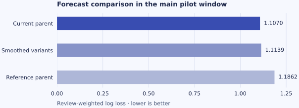

# Product Review Shift Diagnostics

A research prototype for explaining changes in a product family's one-to-five-star rating distribution. The archived retrospective pilot covers **two complete categories** of Amazon Reviews 2023: **All Beauty** and **Subscription Boxes**. The full 34-partition configuration is included for future execution.

## What changes a product family's ratings?

A parent product combines reviews for multiple variants. The distribution can shift even if the ratings within each variant stay the same. This prototype counts stars by parent, variant, and week, then decomposes the change between two windows.

$$
\Delta \mathbf{p} = \mathbf{d}_{\mathrm{within}} + \mathbf{d}_{\mathrm{mix}} + \mathbf{d}_{\mathrm{observed\ variants}}
$$

- **Within-variant change** captures shifts in the rating distributions of variants reviewed in both periods.
- **Review mix** captures changes in the share of reviews going to those shared variants.
- **Observed variants** captures variants with reviews in only one period, relative to a fixed reference distribution.

The terms sum to the observed shift across all five star bins. Their mean-star and low-star summaries describe the published reviews. They cannot identify changes in product quality, sales, or assortment without separate evidence. Moving-week blocks and reviewer resampling probe conditional stability. In a separate synthetic dependence experiment, nominal 95% weekly-block ranges covered the true value in 89% of runs.

## Two-category pilot

| Measure | Archived pilot |
| --- | ---: |
| All Beauty reviews scanned | 701,528 |
| Subscription Boxes reviews scanned | 16,216 |
| Total reviews scanned | 717,744 |
| Reviews retained after deduplication and conflict quarantine | 710,266 |
| Candidate product families in the main window | 15,754 |
| Product families meeting the support rules | 12 |

A qualifying family had at least 30 reviews and four observed weeks in each period, with shared variants representing at least 50% of reviews on each side. All 12 qualifying families had follow-up observations, giving 196 later reviews across the common evaluation cohort.



The simple current-parent baseline beat variant smoothing on both review-weighted log loss and ranked probability score in the main window. Rankings varied by metric in the other rolling windows. The comparisons are retrospective and use the parent–variant mapping available in the published snapshot.

[Pilot audit summary](evidence/pilot-summary.json) · [Rolling forecast scores](evidence/rolling_metrics.csv) · [Reviewer subsampling](evidence/scale_summary.csv) · [Synthetic validation](evidence/mechanism-simulation.json)

## Reproduce the prototype

Use Python 3.13 from the repository root. The synthetic demo runs without downloading reviews and writes an HTML report, diagnostics figure and CSVs to `results/demo/`.

```bash
python3.13 -m venv .venv
source .venv/bin/activate
python -m pip install -r requirements.txt
python -m pytest -q
python -m review_shift demo
```

To rebuild the two-category pilot from the publisher's frozen revision, run the commands below. Ingestion checks file sizes and SHA-256 hashes. The two raw inputs total approximately 336 MB, and processing creates additional local files.

```bash
python -m review_shift run --config configs/pilot.json
python -m review_shift backtest --config configs/pilot.json
```

The [pilot configuration](configs/pilot.json) specifies the support rules, primary windows, and three backtest start dates. The [source manifest](data/manifest.json) pins the inputs. The repository provides aggregate results and source code. Review text, reviewer records, and product-level output can be regenerated locally from the upstream source.

[Decomposition and forecast code](review_shift/analysis.py) · [Ingestion and audit code](review_shift/data.py) · [Validation tests](tests)

Data source: [McAuley Lab's Amazon Reviews 2023](https://amazon-reviews-2023.github.io/), [frozen dataset revision](https://huggingface.co/datasets/McAuley-Lab/Amazon-Reviews-2023/tree/2b6d039ed471f2ba5fd2acb718bf33b0a7e5598e), and [dataset paper](https://arxiv.org/abs/2403.03952). Check the publisher's terms before using the source data.
